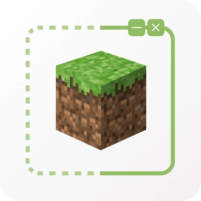
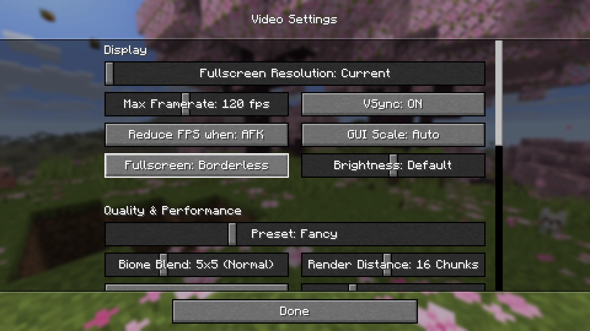
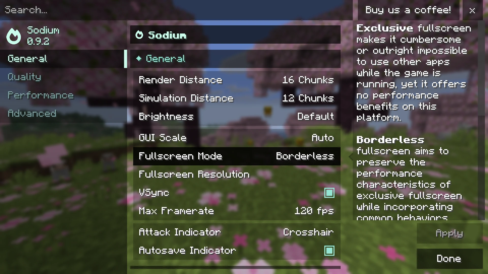
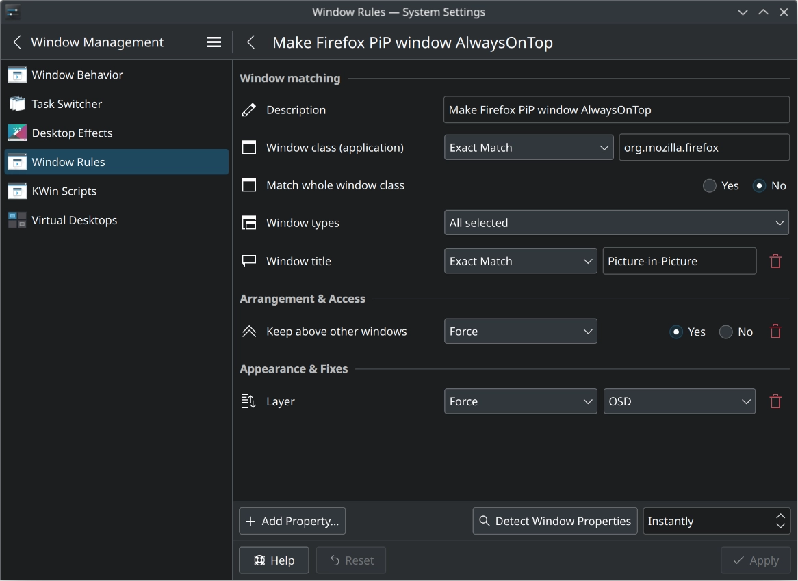
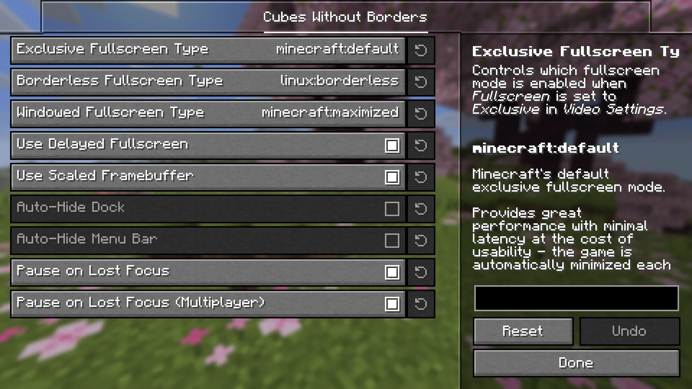

# Cubes Without Borders

[](https://github.com/Kira-NT/cubes-without-borders/actions/workflows/build.yml)
[](https://github.com/Kira-NT/cubes-without-borders/releases/latest)
[](https://modrinth.com/mod/cubes-without-borders)
[](https://www.curseforge.com/minecraft/mc-mods/cubes-without-borders)
[](LICENSE.md)



A mod that allows you to play Minecraft in a borderless fullscreen window. This means you can keep the game open while interacting with other applications on a different monitor, or even directly on top of Minecraft itself, without the game being minimized.

Unlike other "borderless fullscreen" mods, **Cubes Without Borders** is highly configurable, does not hinder your input latency, and explicitly supports all major platforms - Linux, macOS, and even Windows - instead of providing a passable experience for only one group of players while making it seem as though others do not exist.

----

## Usage

To enable non-exclusive fullscreen, go to the `Video Settings` tab, where you would typically find the `Fullscreen` setting, and switch it to one of the newly added options: `Borderless` or `Windowed` - whichever works best for you.

Depending on whether you have Sodium installed, you may find these options in one of the following locations:

|  |  |
| - | - |

Additionally, the mod introduces two new startup flags, `--borderless` and `--windowed`, which force the game to launch in borderless or windowed fullscreen mode, respectively, regardless of your current settings.

----

## FAQ

<details>
<summary>I'm a Windows user and...</summary>
<br>

That is a problem indeed, my friend! In all seriousness, though, if you are having issues with borderless fullscreen, you can switch to windowed fullscreen and see which one works better for you.

Additionally, it's generally recommended to use CWB alongside [Sodium](https://modrinth.com/mod/sodium), as it fixes many hardware- and driver-specific issues that might otherwise hinder your experience.

<br>
</details>

<details>
<summary>On Windows, my cursor becomes invisible in inventories when fullscreen is enabled.</summary>
<br>

As mentioned earlier, you can switch to windowed fullscreen in Video Settings, as proper fullscreen mode does not seem to work correctly on your system.

It's worth noting, however, that what you are experiencing is not a problem with the mod, but rather an issue with your system that you might be able to fix. People commonly report their cursor becoming invisible in games on Windows in the following scenarios:

- When using [Medal](https://support.medal.tv/support/solutions/articles/48001258678-troubleshooting-missing-mouse-cursors-in-medal-tv)
- When using OBS on Windows 11 with the ["Windows 10+ Capturing Method"](https://github.com/obsproject/obs-studio/issues/10782) enabled for the source
- When the ["Display pointer trails"](https://learn.microsoft.com/en-us/answers/questions/2617725/invisible-mouse-cursor-in-full-screen-games) option is enabled in the Control Panel
- Due to your usual causes, such as broken and/or outdated drivers

<br>
</details>

<details>
<summary>The mod doesn't seem to work with Sodium.</summary>
<br>

Please, make sure you have the latest versions of both Sodium and CWB installed, and verify that the `Fullscreen Mode` option in Sodium's settings provides four options: `Off`, `Exclusive`, `Borderless`, and `Windowed`. If any of them are missing, or if the setting itself is but a simple toggle, you are using outdated versions of the mods.

No worries, though! Even if you are unable to update, you can always access vanilla Video Settings from Sodium's custom screen by pressing <kbd>Ctrl</kbd> + <kbd>Shift</kbd> + <kbd>P</kbd> - there you'll be able to find the modified Fullscreen setting.

In fact, if you simply toggle fullscreen by pressing <kbd>F11</kbd>, for example, you should immediately jump straight into the borderless mode, as it's set as your preferred fullscreen mode by default.

<br>
</details>

<details>
<summary>On Linux, I want to keep a Picture-in-Picture window opened by my browser on top of the game. However, it always goes behind the game window when I switch my focus back to Minecraft.</summary>
<br>

Due to the stacking order defined by the [FreeDesktop specification](https://specifications.freedesktop.org/wm/latest/), conforming desktop environments like KDE Plasma *(rare GNOME W)* place PiP windows behind focused fullscreen applications. Thankfully, you can always change the layer assigned to the window you want to keep above your game by using window rules. Here's an example of how to do this for Firefox:



</details>

----

## Config

The mod provides a simple configuration screen that can be accessed if you have [`YACL`](https://modrinth.com/mod/yacl) or [`Cloth Config`](https://modrinth.com/mod/cloth-config) installed:



Otherwise, you can configure it by directly editing the `cwb.json` file, stored in your mod loader's default configuration directory:

```jsonc
{
    // Specifies whether the game should start in windowed, exclusive fullscreen,
    // borderless fullscreen, or windowed fullscreen mode.
    //
    // Should be one of: "OFF", "EXCLUSIVE", "BORDERLESS", or "WINDOWED".
    "fullscreenMode": "OFF",

    // Specifies whether the game should enter exclusive or borderless fullscreen mode
    // when a player attempts to switch to fullscreen using a keybinding (e.g., F11).
    //
    // Should be either "EXCLUSIVE", "BORDERLESS", or "WINDOWED".
    "preferredFullscreenMode": "BORDERLESS",

    // Specifies whether to postpone entering fullscreen mode until Minecraft is fully loaded.
    //
    // Enabling this option may result in a smoother startup sequence and can fix rare issues
    // on systems with faulty drivers that do not immediately allow certain windows to enter
    // fullscreen mode at a resolution that differs from the default one.
    "useDelayedFullscreen": true,

    // Specifies whether to use a full-resolution framebuffer on platforms where
    // screen coordinates can be scaled relative to pixel coordinates, such as
    // macOS and Wayland (Linux).
    //
    // Disabling this option may lead to a significant performance boost
    // at the cost of image quality.
    "useScaledFramebuffer": true,

    // On supported platforms (e.g., macOS), specifies whether to automatically
    // hide the dock in non-exclusive fullscreen modes, so it can be revealed by
    // moving the mouse to the edge of the screen, instead of disabling it entirely.
    "autoHideDock": false,

    // On supported platforms (e.g., macOS), specifies whether to automatically
    // hide the menu bar in non-exclusive fullscreen modes, so it can be revealed by
    // moving the mouse to the edge of the screen, instead of disabling it entirely.
    "autoHideMenuBar": false,

    // When "pauseOnLostFocus" is enabled, specifies whether its effect should
    // also apply to multiplayer sessions, where the game cannot be truly paused.
    //
    // Note: "pauseOnLostFocus" is a vanilla option, and should be
    // looked for in the standard "options.txt" file.
    "pauseOnLostFocusDuringMultiplayer": true,

    // Controls which fullscreen mode is enabled when
    // "fullscreenMode" is set to "EXCLUSIVE".
    "exclusiveFullscreenType": "@default",

    // Controls which fullscreen mode is enabled when
    // "fullscreenMode" is set to "BORDERLESS".
    "borderlessFullscreenType": "@borderless",

    // Controls which fullscreen mode is enabled when
    // "fullscreenMode" is set to "WINDOWED".
    "windowedFullscreenType": "@windowed",

    // Provides configuration overrides for the Linux operating system.
    // Properties defined within this section take precedence over
    // their top-level counterparts.
    "linux": {
        "exclusiveFullscreenType": "minecraft:default",
        "borderlessFullscreenType": "linux:borderless",
        "windowedFullscreenType": "minecraft:maximized"
    },

    // Provides configuration overrides for the macOS operating system.
    // Properties defined within this section take precedence over
    // their top-level counterparts.
    "macos": {
        "exclusiveFullscreenType": "minecraft:default",
        "borderlessFullscreenType": "macos:borderless",
        "windowedFullscreenType": "macos:windowed"
    },

    // Provides configuration overrides for the Windows operating system.
    // Properties defined within this section take precedence over
    // their top-level counterparts.
    "windows": {
        "exclusiveFullscreenType": "minecraft:default",
        "borderlessFullscreenType": "minecraft:windowed",
        "windowedFullscreenType": "windows:windowed"
    }
}
```

### Fullscreen Types

| Name | Description |
|------|-------------|
| `minecraft:default` | Minecraft's default exclusive fullscreen mode.<br><br>Provides great performance with minimal latency at the cost of usability - the game is automatically minimized each time its window loses focus. |
| `minecraft:windowed` | A windowed fullscreen mode with performance and UX characteristics that vary depending on the platform.<br><br>On **Windows**, this mode is generally the best way to play the game, as it provides the benefits typical of a borderless fullscreen experience with zero to none performance and latency penalties; however, some users may experience annoying blinking each time the game window gains or loses focus.<br><br>On **other platforms**, this mode may cause significant performance degradation and/or usability issues, such as your system's dock remaining visible or even being rendered on top of the game. |
| `minecraft:maximized` | A windowed fullscreen mode that turns the game into a maximized borderless window.<br><br>Performance and UX characteristics of this mode may vary depending on the platform, but you can generally expect slightly higher latency than that of the default exclusive fullscreen mode due to the implicit V-Sync imposed on all windowed applications by most popular compositors.<br><br>Pairs best with systems with the dock and/or menu bar disabled or configured to hide automatically, or with players who prefer them to stay visible. |
| `linux:borderless` | The default borderless fullscreen mode for Linux and other Unix-likes.<br><br>Provides great performance with minimal latency. Has no known downsides. |
| `macos:borderless` | The default borderless fullscreen mode for macOS.<br><br>Provides decent performance, but has slightly higher latency than that of the default exclusive fullscreen mode due to the implicit V-Sync imposed on all windowed applications by the OS. |
| `macos:windowed` | The default windowed fullscreen mode for macOS.<br><br>Unlike `macos:borderless`, this mode leaves the menu bar visible at all times, which might prove useful for people who dislike the notch on newer MacBooks covering part of their game.<br><br>Provides decent performance, but has slightly higher latency than that of the exclusive fullscreen mode due to the implicit V-Sync imposed on all windowed applications by the OS. |
| `windows:windowed` | The default windowed fullscreen mode for Windows.<br><br>Unlike `minecraft:windowed`, it does not suffer from the blinking issues, but it also lacks the performance benefits of the said mode.<br><br>Its latency is higher than that of the default exclusive fullscreen mode due to the implicit V-Sync imposed on all windowed applications by the OS. Additionally, some users may experience severe performance degradation, as Windows sometimes discards frames provided by windowed applications instead of rendering them, especially when performing background tasks it deems more important than that, such as downloading updates or indexing screenshots of your activity captured by Windows Recall. |

----

## «AI» Policy

This project *(nor any of my other projects, for that matter)* does not accept "AI"-generated or "AI"-assisted contributions.

And while the license does not forbid it, because I want to keep my work open source in the truest sense of the term - available for everyone to modify and redistribute, I ask you not to use my projects as training data, nor to modify them using the aforementioned technology, even for strictly personal use.

As is often the case in our world, there will be no consequences for violating my consent. Except for proving me even more right about the nature of the average "AI" user.

----

## License

Licensed under the terms of the [MIT License](LICENSE.md).
